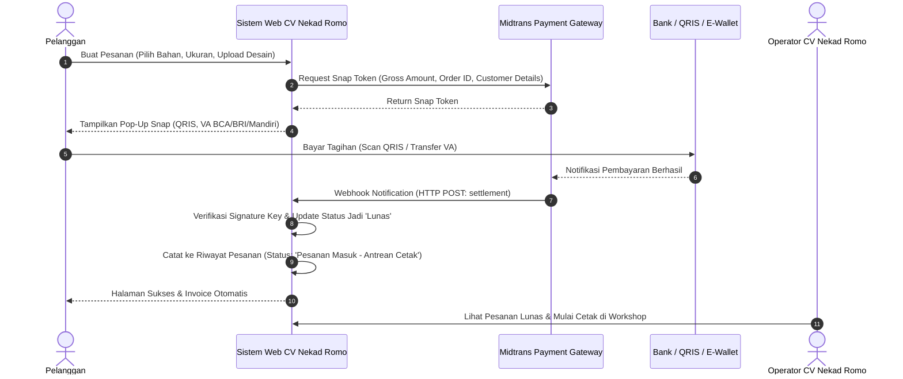
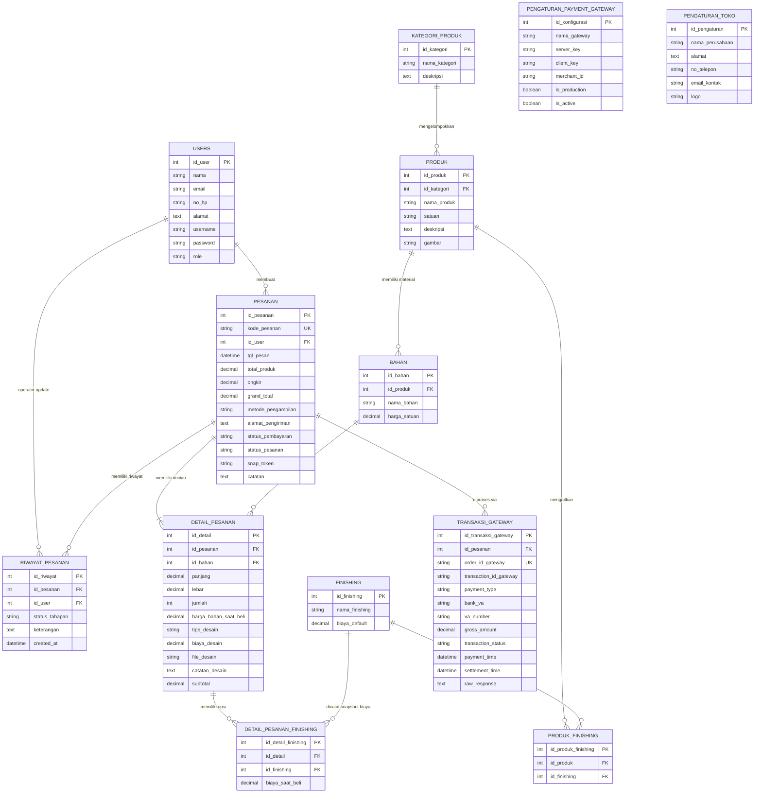

# DOKUMENTASI LENGKAP & SPESIFIKASI PROYEK TUGAS AKHIR

## 1. Identitas Proyek & Tim Penyusun
* **Judul Tugas Akhir**: SISTEM INFORMASI PEMESANAN JASA PERCETAKAN PADA CV NEKAD ROMO KOTA METRO BERBASIS WEB
* **Penyusun**: MUHAMMAD RAIHAN
* **NPM**: 21410020
* **Dosen Pembimbing**:
  1. Pembimbing (1): Mustika, S.Kom., M.Kom.
  2. Pembimbing (2): Mujito, S.Kom., M.Kom.
* **Program Studi**: D-III Sistem Informasi
* **Fakultas**: Fakultas Ilmu Komputer
* **Perguruan Tinggi**: Universitas Muhammadiyah Metro
* **Tahun**: 2024
* **Kata Kunci**: Pemesanan; Aplikasi Website; Jasa Percetakan; CV Nekad Romo; Pemrograman PHP; Payment Gateway.

---

## 2. Intisari Latar Belakang & Masalah Pokok (Bab I & Ringkasan)
### A. Masalah di CV Nekad Romo:
1. **Pemesanan Masih Manual/Konvensional**: Pelanggan/costumer diwajibkan datang langsung ke lokasi percetakan untuk memesan produk (seperti banner, spanduk, leaflet, brosur, dll.). Cara ini dinilai **kurang efektif dan memakan waktu**.
2. **Keterbatasan Jangkauan Pemasaran**: Pemasaran jasa percetakan belum optimal secara daring (*online*).
3. **Verifikasi Pembayaran Konvensional Rentan Masalah**: 
   * Transfer manual mengharuskan pelanggan mengirim bukti transfer/struk ATM/screenshot m-banking yang rawan dipalsukan (*fake proof*).
   * Admin toko harus berulang kali mengecek mutasi rekening secara manual sehingga memperlambat antrean cetak.
4. **Landasan Nilai Transaksi**:
   * Sesuai QS. An-Nisa: 29: Jual beli harus sah atas dasar saling rela dan ridha (*an taradhin minkum*). Sistem web menyediakan transparansi rincian harga, ukuran, bahan, dan kepastian pembayaran otomatis secara real-time.

### B. Solusi & Tujuan Proyek:
* **Tujuan**: Merancang dan membangun aplikasi berbasis web **"Sistem Informasi Pemesanan Jasa Percetakan Pada CV Nekad Romo Kota Metro Berbasis WEB"** yang terintegrasi dengan **Payment Gateway (Midtrans Snap API)**.
* **Keunggulan Payment Gateway**:
  * Pelanggan dapat membayar dengan berbagai kanal resmi: **QRIS (GoPay, OVO, Dana, ShopeePay)**, **Virtual Account (BCA, BRI, BNI, Mandiri, Permata)**, dan **Convenience Store (Indomaret, Alfamart)**.
  * Verifikasi pembayaran **100% otomatis** melalui Webhook/HTTP Notification tanpa perlu unggah struk manual.
  * Status transaksi langsung berubah menjadi `Lunas` seketika saat pelanggan menyelesaikan pembayaran, dan pesanan otomatis masuk ke antrean cetak workshop CV Nekad Romo.

---

## 3. Metodologi Penelitian & Pemodelan Sistem
* **Metode Penelitian**: Kualitatif (Observasi, Wawancara, Dokumentasi, Studi Pustaka).
* **Metode Pengembangan**: SDLC (*System Development Life Cycle*) — Model Waterfall.
* **Alat Pemodelan Sistem**:
  1. **Flowchart**: Prosedur pemesanan dan alur transaksi Payment Gateway.
  2. **Diagram Konteks**: Aliran data antara Pelanggan, Sistem, Admin, Pimpinan, dan Server Payment Gateway.
  3. **DFD (Data Flow Diagram)**: DFD Level 0 & DFD Level 1.
  4. **ERD (Entity Relationship Diagram)**: Normalisasi 1NF sampai 3NF.
* **Metode Pengujian**: Black Box Testing (termasuk skenario pengujian notifikasi Webhook Sandbox).

---

## 4. Alur Integrasi Payment Gateway (Midtrans Snap)

---

## 5. Diagram Relasi Entitas (ERD) Normalisasi 1NF - 3NF

---

## 6. Kamus Data & Definisi Primary Key Lengkap (13 Tabel)

Setiap tabel di bawah ini telah didefinisikan secara tegas **Primary Key (PK)**, tipe data, panjang karakter, sifat `AUTO_INCREMENT`, serta fungsi uniknya:

### 1. Tabel `users`
* **Definisi Primary Key**: `id_user` (`INT(11) AUTO_INCREMENT PRIMARY KEY`)
* Fungsi: Pengenal unik setiap akun pengguna (Pelanggan, Admin, Pimpinan).

### 2. Tabel `kategori_produk`
* **Definisi Primary Key**: `id_kategori` (`INT(11) AUTO_INCREMENT PRIMARY KEY`)
* Fungsi: Pengenal unik kelompok layanan cetak (Outdoor/Indoor, Lembaran, Merchandise).

### 3. Tabel `produk`
* **Definisi Primary Key**: `id_produk` (`INT(11) AUTO_INCREMENT PRIMARY KEY`)
* Fungsi: Pengenal unik jenis produk cetak (Banner, Brosur, Mug).

### 4. Tabel `bahan`
* **Definisi Primary Key**: `id_bahan` (`INT(11) AUTO_INCREMENT PRIMARY KEY`)
* Fungsi: Pengenal unik material cetak dan tarif dasarnya per satuan.

### 5. Tabel `finishing`
* **Definisi Primary Key**: `id_finishing` (`INT(11) AUTO_INCREMENT PRIMARY KEY`)
* Fungsi: Pengenal unik opsi finishing (Mata Ayam, Selongsong, Laminasi).

### 6. Tabel `produk_finishing`
* **Definisi Primary Key**: `id_produk_finishing` (`INT(11) AUTO_INCREMENT PRIMARY KEY`)
* Fungsi: Menautkan opsi finishing yang diizinkan untuk setiap produk (relasi M:N).

### 7. Tabel `pesanan`
* **Definisi Primary Key**: `id_pesanan` (`INT(11) AUTO_INCREMENT PRIMARY KEY`)
* Fungsi: Pengenal unik nomor induk faktur pesanan.
* Fitur Tambahan: Menyimpan `snap_token` untuk transaksi Payment Gateway.

### 8. Tabel `detail_pesanan`
* **Definisi Primary Key**: `id_detail` (`INT(11) AUTO_INCREMENT PRIMARY KEY`)
* Fungsi: Pengenal unik item cetak per pesanan.

### 9. Tabel `detail_pesanan_finishing`
* **Definisi Primary Key**: `id_detail_finishing` (`INT(11) AUTO_INCREMENT PRIMARY KEY`)
* Fungsi: Pengenal unik finishing yang dipilih pada item tertentu (mendukung multi-finishing).

### 10. Tabel `transaksi_gateway` (Pengganti Pembayaran Manual)
* **Definisi Primary Key**: `id_transaksi_gateway` (`INT(11) AUTO_INCREMENT PRIMARY KEY`)
* Fungsi: Menyimpan respon payload, status transaksi, nomor Virtual Account/QRIS, dan waktu pelunasan langsung dari server Payment Gateway.

| No | Nama Kolom | Tipe Data & Panjang | Null | Keterangan / Key |
|---|---|---|---|---|
| 1 | **id_transaksi_gateway** | INT(11) | NO | **Primary Key**, Auto Increment |
| 2 | id_pesanan | INT(11) | NO | Foreign Key ke `pesanan` |
| 3 | order_id_gateway | VARCHAR(50) | NO | ID order unik yang dikirim ke gateway |
| 4 | transaction_id_gateway | VARCHAR(100) | YES | ID transaksi dari server gateway |
| 5 | payment_type | VARCHAR(50) | YES | Jenis bayar (`qris`, `bank_transfer`, dll.) |
| 6 | bank_va | VARCHAR(30) | YES | Bank VA (BCA, BRI, BNI, Mandiri) |
| 7 | va_number | VARCHAR(50) | YES | Nomor Virtual Account pelanggan |
| 8 | bill_key | VARCHAR(50) | YES | Kode bayar Mandiri Bill / Permata |
| 9 | biller_code | VARCHAR(50) | YES | Kode biller perusahaan |
| 10 | qr_code_url | TEXT | YES | URL QR Code QRIS (jika bayar QRIS) |
| 11 | gross_amount | DECIMAL(12,2) | NO | Nominal tagihan |
| 12 | transaction_status | ENUM('pending', 'settlement', 'capture', 'deny', 'expire', 'cancel') | NO | Status transaksi dari Webhook |
| 13 | fraud_status | VARCHAR(30) | YES | Status deteksi penipuan |
| 14 | payment_time | DATETIME | YES | Waktu pembayaran dilakukan |
| 15 | settlement_time | DATETIME | YES | Waktu dana berhasil diselesaikan |
| 16 | raw_response | TEXT | YES | JSON payload lengkap webhook log |
| 17 | created_at | DATETIME | NO | Waktu transaksi dibuat |

### 11. Tabel `riwayat_pesanan`
* **Definisi Primary Key**: `id_riwayat` (`INT(11) AUTO_INCREMENT PRIMARY KEY`)
* Fungsi: Pengenal unik kronologi audit trail (misal: "Otomatis Lunas via Midtrans QRIS").

### 12. Tabel `pengaturan_payment_gateway`
* **Definisi Primary Key**: `id_konfigurasi` (`INT(11) AUTO_INCREMENT PRIMARY KEY`)
* Fungsi: Konfigurasi API Client Key, Server Key, dan toggle mode Sandbox/Production.

| No | Nama Kolom | Tipe Data & Panjang | Null | Keterangan / Key |
|---|---|---|---|---|
| 1 | **id_konfigurasi** | INT(11) | NO | **Primary Key**, Auto Increment |
| 2 | nama_gateway | VARCHAR(50) | NO | Nama provider (Midtrans) |
| 3 | server_key | VARCHAR(255) | NO | Server Key API rahasia |
| 4 | client_key | VARCHAR(255) | NO | Client Key API untuk frontend Snap JS |
| 5 | merchant_id | VARCHAR(50) | YES | Merchant ID Midtrans |
| 6 | is_production | TINYINT(1) | NO | 0 = Mode Sandbox (uji coba), 1 = Production |
| 7 | is_active | TINYINT(1) | NO | Status keaktifan gateway |

### 13. Tabel `pengaturan_toko`
* **Definisi Primary Key**: `id_pengaturan` (`INT(11) AUTO_INCREMENT PRIMARY KEY`)
* Fungsi: Profil instansi CV Nekad Romo Kota Metro.
